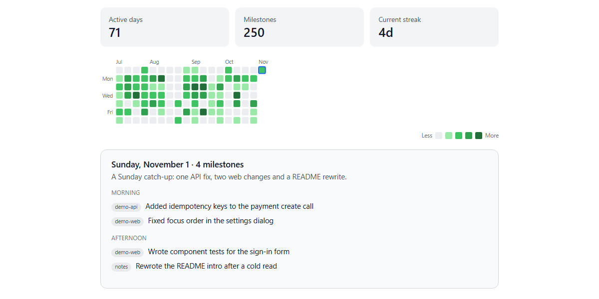

# Kudos

Give yourself credit for the work you actually do.

Kudos is a Claude Code plugin that quietly watches the repos and folders you work in, then turns your incremental daily work into an honest log and a GitHub-style contribution heatmap. It is for the feeling of "I never notice my own progress, I only see the end result." Now you can see the days you showed up.



## Install

### Claude Code (CLI)
```bash
claude plugin marketplace add gentsk77/kudos
claude plugin install kudos@kudos
```

### Cowork (desktop app)
Customize -> Plugins -> add marketplace `https://github.com/gentsk77/kudos`, then install **Kudos**.
Or: Customize -> Plugins -> Upload local plugin, and upload `dist/kudos.zip`.

## Get started
1. `/kudos:setup` - pick what to track, calendar, tone, and register the daily snapshot. (Needs Node.js 18+ on PATH.)
2. `/kudos:recap` - summarize today. Or `/kudos:recap 7d`, `/kudos:recap 2026-06-25`, `/kudos:recap 2026-06-20..2026-06-26`.
3. `/kudos:watch <path>` - add another repo or folder anytime.
4. The recap renders the heatmap + breakdown **inline** in chat - no file to hunt for.

## Requirements
- Node.js 18 or newer on your PATH (the snapshot and setup scripts are plain Node with no dependencies), and git.
- The inline heatmap renders in Claude desktop and Cowork. In the Claude Code CLI there is no inline widget, so the recap shows the same days as a text strip of shaded squares instead.


## How it works
- A small **node** snapshot script runs on a schedule (Windows Task Scheduler / cron) and captures working-tree state locally. No AI, no network.
- `/kudos:recap` reconstructs a day (or range) from git history + file mtimes + (optionally) your calendar, writes an honest log, and renders the contribution heatmap inline. The rules live in `~/.kudos/HANDBOOK.md` - yours to tune.
- Everything personal lives in your data home `~/.kudos/` (override with `KUDOS_HOME`). The plugin itself stores no data, and **updating the plugin never touches your data** - `/kudos:setup` after an update only migrates config, never wipes.

## What a log entry looks like
`/kudos:recap` writes one entry per day to `~/.kudos/data/daily-log.md` (and the same data to `data/progress.json`, which feeds the heatmap). This one comes from the made-up dataset in [`examples/progress.sample.json`](examples/progress.sample.json), which is also what the heatmap above was rendered from:

```markdown
## 2026-11-01
A Sunday catch-up: one API fix, two web changes and a README rewrite. (4 milestones)

**Morning**
- demo-api: Added idempotency keys to the payment create call
- demo-web: Fixed focus order in the settings dialog

**Afternoon**
- demo-web: Wrote component tests for the sign-in form
- notes: Rewrote the README intro after a cold read
```

Heatmap color follows the milestone count for the day, not lines changed. Only your own commits count: the recap filters `git log` by your configured git email, so teammates' commits in a shared repo are not credited to you.

## Privacy
- Snapshots, your log, and your config are stored locally in `~/.kudos/` (or `KUDOS_HOME`). The scheduled snapshot script makes no network calls and uses no AI.
- Snapshots copy files. Three times a day the script saves `git diff HEAD` and a copy of every untracked text file under 1 MB in each watched repo into the data home, and it does not prune old snapshots. An untracked file that is not gitignored (a `.env`, for example) gets copied too. Gitignored files are skipped, so add such paths to `.gitignore`.
- The recap step does send data off your machine. When you run `/kudos:recap`, the diffs of your watched repos for that range are read by the model that runs the command, so they go to your model provider like any other Claude Code context.
- The published plugin contains no personal data.

## Successor
Kudos was a one-evening prototype (2026-06-26). Its recap half was absorbed the next day into Cairn, the plugin I use daily; Kudos stays as the small standalone version.

## Layout
```
.claude-plugin/marketplace.json   marketplace manifest
plugins/kudos/                    the plugin
  .claude-plugin/plugin.json
  skills/{setup,watch,recap}/
  scripts/                        node core + per-OS scheduler + build
  assets/                         HANDBOOK, inline-heatmap, config templates
dist/kudos.zip                    uploadable plugin bundle
examples/progress.sample.json     made-up 18-week dataset in the progress.json format
docs/heatmap.png                  heatmap rendered from the sample dataset
```
